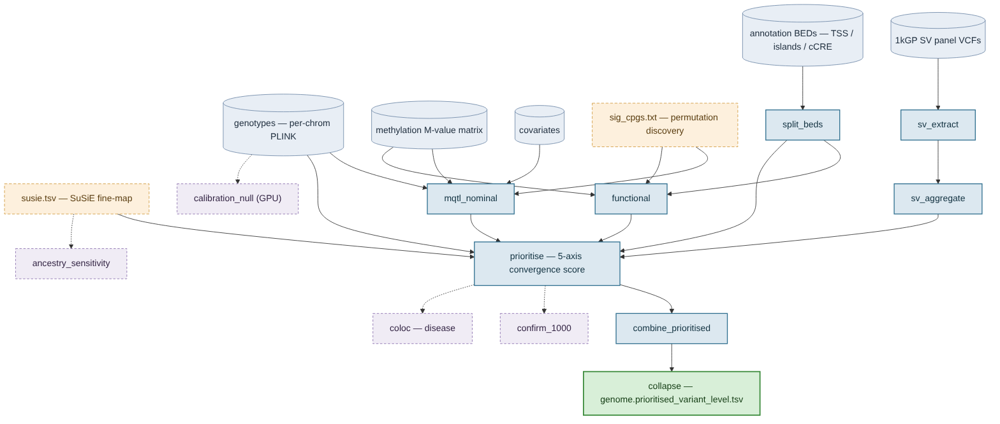

# cis-mQTL Convergence Framework

A reproducible [Snakemake](https://snakemake.readthedocs.io) workflow for discovering and
prioritising **cis-methylation QTLs (mQTLs)** from population-scale genotype and DNA-methylation
data, and integrating them with disease GWAS.

Developed for a Master of Bioinformatics dissertation (University of Western Australia), applied
to multi-ancestry Oxford Nanopore long-read data from 452 individuals.

> **Scope of this repository.** This is the **pipeline framework only**: workflow definition, rule
> structure, cluster profile and configuration schema. It contains **no data, results or analysis
> outputs**, as the underlying study is unpublished. Paths in `config/config.yaml` are placeholders.

---

## The workflow



The DAG runs from raw inputs to a ranked list of candidate regulatory variants:

| Stage | Rule | What it does |
|---|---|---|
| QTL mapping | `mqtl_nominal` | cis-mQTL nominal pass per chromosome (tensorQTL) |
| Fine-mapping | *(upstream input)* | Bayesian fine-mapping credible sets and PIPs (SuSiE) |
| Annotation | `split_beds`, `functional` | TSS, CpG-island and cCRE annotation per chromosome |
| SV linkage | `sv_extract`, `sv_aggregate` | Structural-variant genotypes and per-variant linkage |
| Prioritisation | `prioritise` | Five-axis convergence score |
| Aggregation | `combine_prioritised`, `collapse` | Genome-wide table, collapsed to variant level |
| Branches | `calibration_null`, `confirm_1000`, `coloc`, `ancestry_sensitivity` | Null calibration, permutation confirmation, colocalisation, per-superpopulation sensitivity |

The **five-axis convergence score** ranks variants by combining fine-mapping posterior inclusion
probability, allele-specific methylation, regulatory element overlap, structural-variant linkage,
and effect size.

## Design notes

- **One command runs the whole DAG.** Rules declare only their inputs and outputs; Snakemake derives
  the execution order by matching them, so no stage ordering is hard-coded.
- **Resume-aware.** Re-running executes only what is missing or stale, which replaces hand-rolled
  "done" sentinel files and manual skip logic.
- **Config-driven portability.** Every path and parameter lives in `config/config.yaml`. Applying
  the framework to a new cohort means swapping a config file, not editing code.
- **Cluster-native.** With the PBS profile, each rule is submitted as its own right-sized job
  (CPU or GPU) and the 22 chromosomes run in parallel rather than serially.
- **Canonical outputs.** Stages that can produce differently-named artifacts (for example large
  chromosomes processed in split halves then merged) are normalised behind one stable filename, so
  downstream rules never branch on how an input was computed.

## Usage

```bash
# environment
micromamba create -n smk -c bioconda -c conda-forge \
    snakemake-minimal snakemake-executor-plugin-cluster-generic graphviz
micromamba activate smk

# dry-run: show the DAG and what would execute (always do this first)
snakemake -n

# full run, each rule submitted as its own PBS job
snakemake --profile profile/pbs

# run a single stage
snakemake mqtl_nominal_all --profile profile/pbs

# regenerate the rule graph
snakemake --rulegraph | dot -Tpng > docs/rulegraph.png
```

To apply the framework to a different cohort:

```bash
cp config/config.yaml config/other_cohort.yaml   # edit paths
snakemake --configfile config/other_cohort.yaml --profile profile/pbs
```

## Layout

```
Snakefile                 top level: config, includes, default target
rules/
  mqtl_nominal.smk        QTL mapping stage
  downstream.smk          SV, annotation, prioritisation, aggregation, branches
config/config.yaml        all paths and the five-axis parameters (placeholders)
profile/pbs/
  config.yaml             Snakemake cluster-generic profile
  qsub.sh                 submit wrapper (GPU-aware, forwards cache env vars)
  qstat-status.sh         PBS job status checker
docs/                     pipeline figure
```

## Requirements

- Snakemake 9 with `snakemake-executor-plugin-cluster-generic`
- Python and R analysis environments (tensorQTL, SuSiE, plink2, bcftools)
- A PBS Pro cluster for the provided profile; the workflow itself is scheduler-agnostic

## Notes

The `profile/pbs/` scripts are written for PBS Pro and assume a project code and storage mounts;
set these for your own system before use. Analysis scripts invoked by the rules are not included
in this repository.

## Licence

MIT. See [LICENSE](LICENSE).
